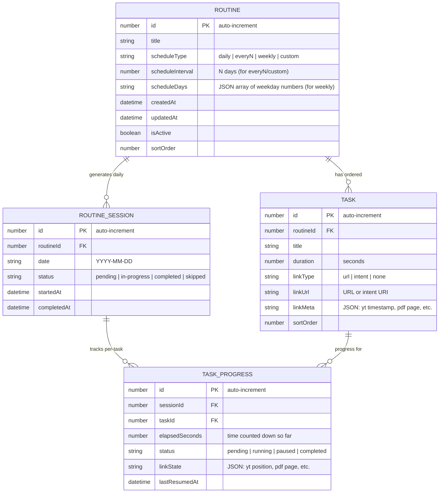
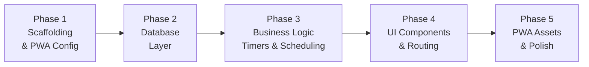

# SkillForge — Task Management PWA: Implementation Plan

## Goal
Build a fully offline Progressive Web App (PWA) for Android that helps users manage **routines** — recurring blocks of skill-building tasks (e.g. vocabulary practice, lecture watching, book reading). Each routine contains ordered tasks with countdown timers. The app runs entirely client-side, stores all data in IndexedDB, and can open external content (YouTube, PDFs, apps) via URLs/intents.

## Tech Stack

| Layer | Technology |
|---|---|
| Framework | **SvelteKit** (Svelte 5, runes) |
| Language | **TypeScript** |
| Adapter | `@sveltejs/adapter-static` (SPA mode, no SSR) |
| PWA | `@vite-pwa/sveltekit` (service worker, manifest, offline caching) |
| Database | **Dexie.js** v4 (IndexedDB wrapper) |
| UI | **SMUI** (Svelte Material UI) — most mature MD3-compatible library |
| CSS | SMUI theme + custom CSS variables for Material You colors |
| Build | Vite |
| Package Manager | pnpm |

> [!NOTE]
> SMUI is chosen over `m3-svelte` because it has a significantly larger component library (dialogs, snackbars, drawers, FABs, cards, data tables) and better documentation. SMUI tracks the Material Design spec closely and supports theming via Sass variables.

---

## Data Model



> [!IMPORTANT]
> **Timer persistence strategy**: When a timer is running (`status = running`), we store `lastResumedAt` and `elapsedSeconds`. On app resume/reload, elapsed time is recalculated as: `elapsedSeconds + (now - lastResumedAt)`. This ensures the timer survives app backgrounding, tab switching, and device sleep.

---

## Project Structure

```
task-manager/
├── static/
│   ├── favicon.ico
│   ├── pwa-192x192.png
│   ├── pwa-512x512.png
│   └── robots.txt
├── src/
│   ├── lib/
│   │   ├── db/
│   │   │   ├── database.ts          # Dexie DB instance & schema
│   │   │   ├── routines.ts          # CRUD operations for routines
│   │   │   ├── tasks.ts             # CRUD operations for tasks
│   │   │   ├── sessions.ts          # Session management & scheduling logic
│   │   │   └── types.ts             # TypeScript interfaces
│   │   ├── stores/
│   │   │   ├── timer.ts             # Timer store (countdown logic)
│   │   │   └── activeSession.ts     # Currently active session state
│   │   ├── components/
│   │   │   ├── RoutineCard.svelte    # Routine summary card for home screen
│   │   │   ├── TaskItem.svelte       # Single task row with timer controls
│   │   │   ├── TimerDisplay.svelte   # Circular countdown timer component
│   │   │   ├── RoutineForm.svelte    # Create/edit routine form
│   │   │   ├── TaskForm.svelte       # Create/edit task within routine
│   │   │   ├── SchedulePicker.svelte # Schedule type selector
│   │   │   ├── LinkEditor.svelte     # URL/intent link configuration
│   │   │   ├── BottomNav.svelte      # Bottom navigation bar
│   │   │   └── ConfirmDialog.svelte  # Reusable confirmation dialog
│   │   └── utils/
│   │       ├── scheduler.ts          # Determines which routines are due today
│   │       ├── links.ts              # URL/intent builder (yt timestamp, etc.)
│   │       ├── time.ts               # Format seconds to mm:ss, etc.
│   │       └── notifications.ts      # Browser Notification API wrapper
│   ├── routes/
│   │   ├── +layout.svelte            # App shell, bottom nav, PWA registration
│   │   ├── +layout.ts                # ssr = false, csr = true
│   │   ├── +page.svelte              # Home: today's active routines
│   │   ├── routines/
│   │   │   ├── +page.svelte          # Manage all routines list
│   │   │   ├── new/
│   │   │   │   └── +page.svelte      # Create new routine
│   │   │   └── [id]/
│   │   │       ├── +page.svelte      # View/edit routine details & tasks
│   │   │       └── session/
│   │   │           └── +page.svelte  # Active session: timer + task list
│   │   └── history/
│   │       └── +page.svelte          # Completion history view
│   └── app.html                      # HTML shell
├── svelte.config.js
├── vite.config.ts
├── tsconfig.json
├── package.json
└── theme/
    └── _smui-theme.scss              # SMUI Material You theme overrides
```

---

## Proposed Changes

### Phase 1: Project Scaffolding & Infrastructure

#### [NEW] package.json
SvelteKit project with these dependencies:
```json
{
  "devDependencies": {
    "@sveltejs/adapter-static": "^3",
    "@sveltejs/kit": "^2",
    "@vite-pwa/sveltekit": "^0",
    "svelte": "^5",
    "typescript": "^5",
    "vite": "^6",
    "sass": "^1"
  },
  "dependencies": {
    "dexie": "^4",
    "@smui/button": "^7",
    "@smui/card": "^7",
    "@smui/dialog": "^7",
    "@smui/fab": "^7",
    "@smui/icon-button": "^7",
    "@smui/linear-progress": "^7",
    "@smui/list": "^7",
    "@smui/snackbar": "^7",
    "@smui/textfield": "^7",
    "@smui/select": "^7",
    "@smui/top-app-bar": "^7",
    "@smui/chips": "^7",
    "@smui/checkbox": "^7",
    "@smui/switch": "^7"
  }
}
```

#### [NEW] svelte.config.js
```javascript
import adapter from '@sveltejs/adapter-static';

export default {
  kit: {
    adapter: adapter({
      pages: 'build',
      assets: 'build',
      fallback: 'index.html',  // SPA fallback
      precompress: false,
      strict: true
    })
  }
};
```

#### [NEW] vite.config.ts
```typescript
import { sveltekit } from '@sveltejs/kit/vite';
import { SvelteKitPWA } from '@vite-pwa/sveltekit';
import { defineConfig } from 'vite';

export default defineConfig({
  plugins: [
    sveltekit(),
    SvelteKitPWA({
      registerType: 'autoUpdate',
      manifest: {
        name: 'SkillForge',
        short_name: 'SkillForge',
        description: 'Routine-based skill building with timers',
        theme_color: '#6750A4',     // MD3 primary purple
        background_color: '#FFFBFE',
        display: 'standalone',
        orientation: 'portrait',
        start_url: '/',
        scope: '/',
        icons: [
          { src: 'pwa-192x192.png', sizes: '192x192', type: 'image/png' },
          { src: 'pwa-512x512.png', sizes: '512x512', type: 'image/png', purpose: 'any maskable' }
        ]
      },
      workbox: {
        globPatterns: ['**/*.{js,css,html,ico,png,svg,webp,woff,woff2}']
      },
      devOptions: {
        enabled: true,
        type: 'module'
      }
    })
  ]
});
```

#### [NEW] src/routes/+layout.ts
```typescript
export const ssr = false;
export const csr = true;
export const prerender = false;
```

---

### Phase 2: Database Layer

#### [NEW] src/lib/db/types.ts
TypeScript interfaces for all entities:

```typescript
export interface Routine {
  id?: number;
  title: string;
  scheduleType: 'daily' | 'everyN' | 'weekly' | 'custom';
  scheduleInterval?: number;       // for everyN / custom
  scheduleDays?: number[];          // for weekly: 0=Sun..6=Sat
  createdAt: Date;
  updatedAt: Date;
  isActive: boolean;
  sortOrder: number;
}

export interface Task {
  id?: number;
  routineId: number;
  title: string;
  duration: number;                 // seconds
  linkType: 'url' | 'intent' | 'none';
  linkUrl?: string;
  linkMeta?: Record<string, unknown>; // { ytTimestamp: 90, pdfPage: 42 }
  sortOrder: number;
}

export interface RoutineSession {
  id?: number;
  routineId: number;
  date: string;                     // 'YYYY-MM-DD'
  status: 'pending' | 'in-progress' | 'completed' | 'skipped';
  startedAt?: Date;
  completedAt?: Date;
}

export interface TaskProgress {
  id?: number;
  sessionId: number;
  taskId: number;
  elapsedSeconds: number;
  status: 'pending' | 'running' | 'paused' | 'completed';
  linkState?: Record<string, unknown>;
  lastResumedAt?: Date;
}
```

#### [NEW] src/lib/db/database.ts
```typescript
import Dexie, { type EntityTable } from 'dexie';
import type { Routine, Task, RoutineSession, TaskProgress } from './types';

const db = new Dexie('SkillForgeDB') as Dexie & {
  routines: EntityTable<Routine, 'id'>;
  tasks: EntityTable<Task, 'id'>;
  sessions: EntityTable<RoutineSession, 'id'>;
  taskProgress: EntityTable<TaskProgress, 'id'>;
};

db.version(1).stores({
  routines: '++id, title, isActive, sortOrder',
  tasks: '++id, routineId, sortOrder',
  sessions: '++id, routineId, date, status, [routineId+date]',
  taskProgress: '++id, sessionId, taskId, status, [sessionId+taskId]'
});

export { db };
```

#### [NEW] src/lib/db/routines.ts
CRUD for routines — `createRoutine`, `updateRoutine`, `deleteRoutine` (cascades to tasks/sessions), `getRoutine`, `getAllRoutines`, `reorderRoutines`.

#### [NEW] src/lib/db/tasks.ts
CRUD for tasks within a routine — `addTask`, `updateTask`, `deleteTask`, `getTasksForRoutine`, `reorderTasks`.

#### [NEW] src/lib/db/sessions.ts
Session lifecycle — `getOrCreateTodaySession`, `startSession`, `completeSession`, `getSessionHistory`.

---

### Phase 3: Core Business Logic

#### [NEW] src/lib/utils/scheduler.ts
Determines which routines are due today:

```typescript
export function isRoutineDueToday(routine: Routine, today: Date): boolean {
  switch (routine.scheduleType) {
    case 'daily':
      return true;
    case 'everyN':
    case 'custom': {
      // Days since creation, mod interval
      const daysSinceCreation = diffDays(routine.createdAt, today);
      return daysSinceCreation % (routine.scheduleInterval ?? 1) === 0;
    }
    case 'weekly':
      return (routine.scheduleDays ?? []).includes(today.getDay());
    default:
      return false;
  }
}
```

#### [NEW] src/lib/stores/timer.ts
Svelte 5 reactive timer store using `$state` and `$effect`:

```typescript
// Core timer logic:
// - Stores { elapsedSeconds, totalDuration, status, lastResumedAt }
// - Uses setInterval(1000) for UI ticks when running
// - On pause: saves elapsedSeconds + delta to DB
// - On resume: sets lastResumedAt = now, restarts interval
// - On complete (elapsed >= duration): fires notification, stops
// - Survives page reload: recalculates from DB state
```

> [!NOTE]
> The timer uses `setInterval` for display updates but relies on `Date.now() - lastResumedAt` for actual elapsed time calculation. This avoids drift from `setInterval` inaccuracies and correctly handles backgrounding.

#### [NEW] src/lib/utils/links.ts
URL/intent builder:

```typescript
export function buildTaskLink(task: Task): string | null {
  if (task.linkType === 'none' || !task.linkUrl) return null;

  let url = task.linkUrl;
  const meta = task.linkMeta ?? {};

  // YouTube: append timestamp
  if (url.includes('youtube.com/watch') || url.includes('youtu.be/')) {
    const timestamp = meta.ytTimestamp as number;
    if (timestamp) {
      const sep = url.includes('?') ? '&' : '?';
      url += `${sep}t=${timestamp}s`;
    }
  }

  // Intent scheme for Android apps
  if (task.linkType === 'intent') {
    // Format: intent://...#Intent;scheme=https;package=com.app;end;
    return url; // User provides full intent URI
  }

  return url;
}

export function openTaskLink(task: Task): void {
  const url = buildTaskLink(task);
  if (url) {
    window.open(url, '_blank');
  }
}
```

#### [NEW] src/lib/utils/notifications.ts
```typescript
export async function requestNotificationPermission(): Promise<boolean> {
  if (!('Notification' in window)) return false;
  const result = await Notification.requestPermission();
  return result === 'granted';
}

export function notifyTaskComplete(taskTitle: string): void {
  if (Notification.permission === 'granted') {
    new Notification('Timer Complete!', {
      body: `"${taskTitle}" timer has finished.`,
      icon: '/pwa-192x192.png',
      tag: 'task-complete'
    });
  }
}
```

---

### Phase 4: UI Components

#### [NEW] src/routes/+layout.svelte
App shell with Material top app bar and bottom navigation:

```svelte
<!-- Top App Bar: "SkillForge" -->
<!-- Bottom Nav: Today | Routines | History -->
<!-- PWA registration via virtual:pwa-register -->
<!-- Notification permission prompt on first load -->
```

Three tabs in bottom navigation:
1. **Today** (`/`) — active routines for today
2. **Routines** (`/routines`) — manage all routines
3. **History** (`/history`) — completion log

---

#### [NEW] src/routes/+page.svelte — Home Screen
The primary screen. Shows routines scheduled for today as cards:

```
┌─────────────────────────────────┐
│  SkillForge            [≡]     │
├─────────────────────────────────┤
│                                 │
│  📅 Today, Nov 7               │
│                                 │
│  ┌───────────────────────────┐  │
│  │ 🇪🇸 Spanish Practice      │  │
│  │ 3 tasks · 45 min total    │  │
│  │ ██████░░░░░ 60%           │  │
│  │              [▶ Continue]  │  │
│  └───────────────────────────┘  │
│                                 │
│  ┌───────────────────────────┐  │
│  │ 📖 Reading Session        │  │
│  │ 2 tasks · 30 min total    │  │
│  │ ░░░░░░░░░░░ Not started   │  │
│  │              [▶ Start]     │  │
│  └───────────────────────────┘  │
│                                 │
│  ┌───────────────────────────┐  │
│  │ ✅ Morning Coding         │  │
│  │ 4 tasks · 60 min total    │  │
│  │ ████████████ Completed ✓  │  │
│  └───────────────────────────┘  │
│                                 │
├─────────────────────────────────┤
│  [Today]  [Routines]  [History] │
└─────────────────────────────────┘
```

Each `RoutineCard` shows: title, task count, total duration, progress bar, and a Start/Continue/Completed button.

---

#### [NEW] src/routes/routines/[id]/session/+page.svelte — Active Session
The core interaction screen when a user is working through a routine:

```
┌─────────────────────────────────┐
│  ← Spanish Practice            │
├─────────────────────────────────┤
│                                 │
│         ┌──────────┐            │
│         │  14:32   │            │
│         │ remaining│            │
│         └──────────┘            │
│     [⏸ Pause]  [⏹ Stop]       │
│                                 │
│  ─── Current Task ───          │
│  ┌───────────────────────────┐  │
│  │ 📹 Watch Lecture #12      │  │
│  │ 20 min countdown          │  │
│  │ [🔗 Open YouTube]         │  │
│  └───────────────────────────┘  │
│                                 │
│  ─── Up Next ───               │
│  ○ Practice Vocabulary (15m)   │
│  ○ Review Notes (10m)          │
│                                 │
│  ─── Completed ───             │
│  ✅ Warm-up Quiz (5m)          │
│                                 │
├─────────────────────────────────┤
│  [Today]  [Routines]  [History] │
└─────────────────────────────────┘
```

Key interactions:
- **Pause/Resume**: Toggles the countdown timer
- **Open Link**: Opens the task's URL/intent in a new tab/app
- **Complete Task**: Marks current task done, highlights next task
- **Complete All**: When last task finishes, session marked completed

---

#### [NEW] src/routes/routines/new/+page.svelte — Create Routine
Form with:
- Routine title (text field)
- Schedule type (segmented button: Daily / Every N / Weekly / Custom)
- Schedule config (conditional: interval input or day-of-week chips)
- Task list with inline add/edit/delete/reorder
- Each task: title, duration (minutes input), link type selector, URL input, metadata fields

---

#### [NEW] src/routes/history/+page.svelte — Completion History
Grouped by date, showing which routines were completed, skipped, or partially done. Simple list view — no charts in MVP.

```
📅 Nov 7, 2026
  ✅ Spanish Practice — completed (45 min)
  ⏭ Reading Session — skipped

📅 Nov 6, 2026
  ✅ Spanish Practice — completed (45 min)
  ✅ Morning Coding — completed (58 min)
  ✅ Reading Session — completed (30 min)
```

---

### Phase 5: PWA Assets & Finalization

#### [NEW] static/pwa-192x192.png, static/pwa-512x512.png
Generated placeholder icons (solid purple circle with "SF" initials, matching MD3 primary color `#6750A4`).

#### [NEW] static/favicon.ico
Matching favicon.

#### Theme configuration
SMUI theme customized with MD3 Material You color tokens:
- Primary: `#6750A4`
- Secondary: `#625B71`
- Tertiary: `#7D5260`
- Surface: `#FFFBFE`
- On-Surface: `#1C1B1F`

---

## User Review Required

> [!IMPORTANT]
> **App Name**: I've tentatively named the app **SkillForge**. Let me know if you'd like a different name.

> [!IMPORTANT]
> **SMUI vs m3-svelte**: I recommend SMUI for its maturity and component breadth, but it targets MD2/MD3 hybrid styling. If pixel-perfect Material You is critical, `m3-svelte` is a purer MD3 implementation but has fewer components. My recommendation is SMUI.

> [!WARNING]
> **Intent URLs on Android**: The `intent://` scheme requires a user gesture to trigger (Chrome security). The app will use standard `window.open(url, '_blank')` for URLs and provide intent URI support as a text field the user fills in. We cannot programmatically discover installed apps from a PWA.

---

## Open Questions

> [!IMPORTANT]
> **YouTube timestamp tracking**: When the user opens a YouTube video and later returns to the app, the app has no way to know where the user paused the video (due to cross-origin restrictions). Should we:
> - (A) Let the user manually update the timestamp before closing the task? ← *recommended*
> - (B) Just always open at the last saved timestamp and let the user seek?
> - (C) Skip timestamp tracking entirely for MVP?

---

## Verification Plan

### Automated Tests
Since this is an MVP, we'll focus on verifying the build and core functionality:

```bash
# 1. Build compiles without errors
pnpm run build

# 2. Type checking passes
pnpm exec svelte-check

# 3. Preview works
pnpm run preview
```

### Manual Verification
1. **PWA Install**: Open in Chrome DevTools → Application → verify service worker registers, manifest loads, "Install" prompt appears
2. **Create Routine**: Add a routine with 3 tasks, verify it persists across page reload (IndexedDB)
3. **Timer**: Start a task timer, pause it, close the tab, reopen — verify elapsed time is correct
4. **Links**: Add a YouTube URL with timestamp, tap "Open" — verify it opens at the right time
5. **Schedule**: Create a daily routine and an every-2-days routine, verify only the correct ones appear on the home screen
6. **Offline**: Enable airplane mode, verify the app still loads and functions
7. **History**: Complete a routine, check the history page shows the completion entry

---

## Build Phases Summary



| Phase | Estimated Files | Description |
|---|---|---|
| 1 | 5 | SvelteKit + static adapter + PWA plugin + layout |
| 2 | 5 | Dexie DB, types, CRUD modules |
| 3 | 4 | Scheduler, timer store, link builder, notifications |
| 4 | 12 | All Svelte components + route pages |
| 5 | 4 | Icons, favicon, theme, final polish |
